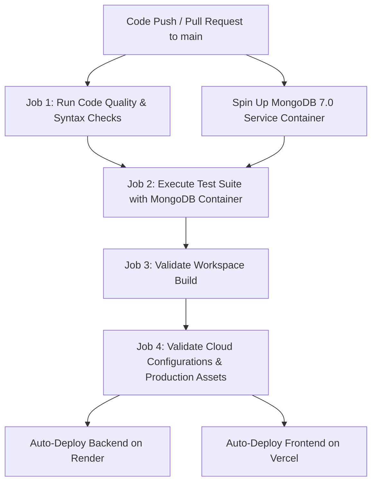
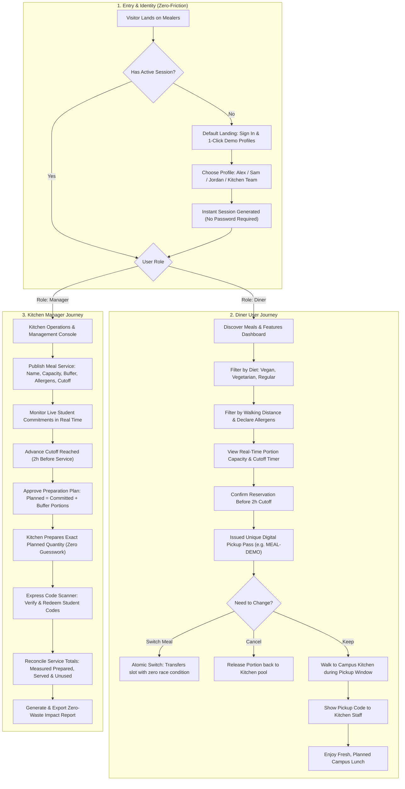
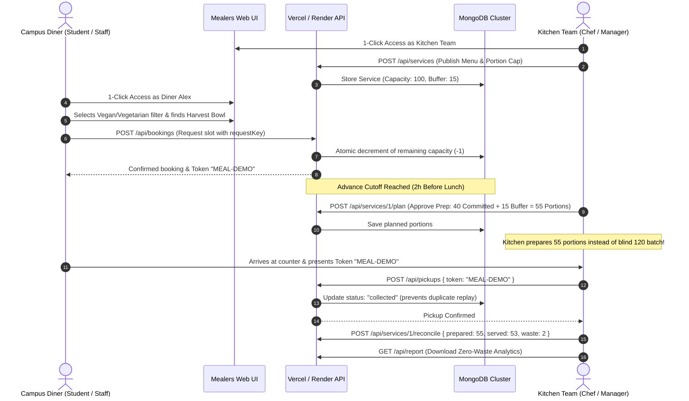

# Mealers — Development & CI/CD Workflow Guide

This guide outlines the end-to-end development, testing, CI/CD pipeline, and cloud deployment workflow for **Mealers**.

---

## 1. Local Development Workflow

### Prerequisites
- **Node.js**: v20.x or v22.x LTS
- **MongoDB** (optional locally; simulated standalone test suite runs without DB)

### Quick Start
```bash
# 1. Install workspace dependencies
npm install
npm --prefix backend install
npm --prefix frontend install

# 2. Run code verification & syntax check
npm run check

# 3. Run test suite
npm test

# 4. Start local development servers
npm run start:backend   # Starts backend on http://127.0.0.1:3001
npm run start:frontend  # Starts frontend on http://127.0.0.1:3000
```

---

## 2. CI/CD Pipeline Workflow (GitHub Actions)

The pipeline is defined in [`.github/workflows/ci.yml`](file:///d:/Devanshi/Project%2024(Mealers)/models/t1/.github/workflows/ci.yml).



### Pipeline Checks
1. **Matrix Build**: Tested across Node `20.x` and `22.x`.
2. **Database Service**: Spun up automatically with `mongo:7.0` container on port `27017`.
3. **Syntax Validation**: `npm run check` verifies all backend modules, serverless proxy functions, and frontend scripts.
4. **Resilient Test Suite**: `npm test` runs full integration tests with MongoDB and fallback unit tests.
5. **Asset Verification**: Checks that favicon, logo, social preview, robots.txt, sitemap, and 404 page exist.

---

## 3. Deployment Pipeline

### Backend on Render
- **Blueprint file**: [`render.yaml`](file:///d:/Devanshi/Project%2024(Mealers)/models/t1/render.yaml)
- **Runtime**: Node.js Web Service
- **Health check**: `GET /api/health`
- **Environment Variables**:
  - `MONGODB_URI`: Connection string from MongoDB Atlas
  - `FRONTEND_ORIGIN`: Your Vercel frontend domain or `*`
  - `NODE_ENV`: `production`

### Frontend on Vercel
- **Config file**: [`vercel.json`](file:///d:/Devanshi/Project%2024(Mealers)/models/t1/vercel.json)
- **Serverless API Proxy**: [`api/[...path].js`](file:///d:/Devanshi/Project%2024(Mealers)/models/t1/api/[...path].js)
- **Environment Variables**:
  - `BACKEND_URL`: URL of your Render backend (e.g. `https://mealers-backend.onrender.com`)

---

## 4. Account & Demo Profile Workflow

- **First Page Experience**: Visitors without an active session land directly on the **Sign In & Demo Profiles** page.
- **Zero Authentication for Demo Accounts**:
  - Alex (Existing Diner), Sam (Fresh Diner), Jordan (Vegetarian), and Kitchen Team (Manager) require **zero password**.
  - 1-click instant login logs into that role immediately without authentication barriers.
- **Role Features Console**:
  - **Diners**: Access portion bookings, atomic meal switching, dietary preference filtering, and instant pickup codes.
  - **Kitchen Team**: Access prep planning, capacity buffer tuning, express code validation (`MEAL-DEMO`), and zero-waste report exports.


---

## 5. End-to-End User Workflows

Mealers orchestrates a synchronized zero-waste dining cycle between two primary campus actors: **Diners** (students and campus staff) and **Kitchen Managers** (cafeteria chefs and dining hall directors).



---

### Detailed Diner User Workflow (Step-by-Step)

| Step | Action | Feature Highlight |
| :--- | :--- | :--- |
| **1. Onboarding** | Land on the app. Click **"Log in as Alex"** or **"Log in as Sam"**. | **Zero Authentication Barrier**: 1-click instant demo access with no password prompt. |
| **2. Feature Tour** | View the **Active Perks Banner** at the top of the workspace. | Unlocks Portion Passes, Allergen Shield, and Meal Switching guarantees. |
| **3. Meal Discovery** | Browse menus from nearby campus kitchens (Commons, Garden, North). | Filters by walk time (1-30 min), category (Vegan/Vegetarian), and declared allergens. |
| **4. Reservation** | Click **"Choose this meal"** before the 2-hour cutoff time. | Idempotent booking locking 1 reserved portion before prep starts. |
| **5. Meal Flexibility** | Click **"Switch to this meal"** if plans change. | **Atomic Slot Transfer**: Source slot is released only if the target slot succeeds. |
| **6. Pickup Pass** | Open **"My meals"** tab. Click **"Copy Code"** on the digital pass. | High-contrast monospace code (`MEAL-DEMO`) with 1-click clipboard integration. |
| **7. Collection** | Show code at the counter during the pickup window. | Instant confirmation; status updates to "Collected". |

---

### Detailed Kitchen Manager Workflow (Step-by-Step)

| Step | Action | Feature Highlight |
| :--- | :--- | :--- |
| **1. Operator Access** | Select **"Kitchen Team"** from the demo cards or top dropdown. | Direct entry into the **Kitchen Manager Workspace**. |
| **2. Menu Publishing** | Click **"+ Publish Meal"** in the action bar. | Define total capacity, walk-in buffer, price, walk distance, cutoff, and allergens. |
| **3. Capacity Control** | Observe the visual reservation progress bar as students commit. | Portions remain bookable only up to `Capacity - Buffer`. |
| **4. Prep Approval** | At cutoff time, click **"Approve preparation plan"**. | Approves exact portions to cook: committed orders plus safety buffer. |
| **5. Verification** | Input student code in **"Confirm meal pickup"** panel. | Replay protection prevents double-serving; audit event is recorded. |
| **6. Reconciliation** | After dining hours, click **"Record service totals"**. | Enters prepared, served, and unused portions to compute cafeteria efficiency. |
| **7. Intelligence** | Open **"Insights"** tab and click **"Export demo report"**. | Exports structured JSON report of portions saved and waste eliminated. |

---

### Cross-Role Interaction Cycle


