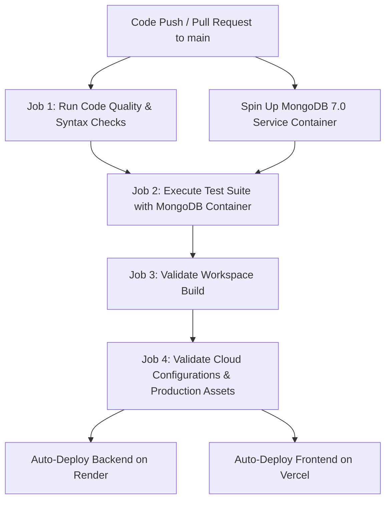

# Mealers — Development & CI/CD Workflow Guide

This guide outlines the end-to-end development, testing, CI/CD pipeline, and cloud deployment workflow for **Mealers**.

---

## 1. Local Development Workflow

### Prerequisites
- **Node.js**: v20.x or v22.x LTS
- **MongoDB** (optional locally; simulated standalone test suite runs without DB)

### Quick Start
```bash
# 1. Install workspace dependencies
npm install
npm --prefix backend install
npm --prefix frontend install

# 2. Run code verification & syntax check
npm run check

# 3. Run test suite
npm test

# 4. Start local development servers
npm run start:backend   # Starts backend on http://127.0.0.1:3001
npm run start:frontend  # Starts frontend on http://127.0.0.1:3000
```

---

## 2. CI/CD Pipeline Workflow (GitHub Actions)

The pipeline is defined in [`.github/workflows/ci.yml`](file:///d:/Devanshi/Project%2024(Mealers)/models/t1/.github/workflows/ci.yml).



### Pipeline Checks
1. **Matrix Build**: Tested across Node `20.x` and `22.x`.
2. **Database Service**: Spun up automatically with `mongo:7.0` container on port `27017`.
3. **Syntax Validation**: `npm run check` verifies all backend modules, serverless proxy functions, and frontend scripts.
4. **Resilient Test Suite**: `npm test` runs full integration tests with MongoDB and fallback unit tests.
5. **Asset Verification**: Checks that favicon, logo, social preview, robots.txt, sitemap, and 404 page exist.

---

## 3. Deployment Pipeline

### Backend on Render
- **Blueprint file**: [`render.yaml`](file:///d:/Devanshi/Project%2024(Mealers)/models/t1/render.yaml)
- **Runtime**: Node.js Web Service
- **Health check**: `GET /api/health`
- **Environment Variables**:
  - `MONGODB_URI`: Connection string from MongoDB Atlas
  - `FRONTEND_ORIGIN`: Your Vercel frontend domain or `*`
  - `NODE_ENV`: `production`

### Frontend on Vercel
- **Config file**: [`vercel.json`](file:///d:/Devanshi/Project%2024(Mealers)/models/t1/vercel.json)
- **Serverless API Proxy**: [`api/[...path].js`](file:///d:/Devanshi/Project%2024(Mealers)/models/t1/api/[...path].js)
- **Environment Variables**:
  - `BACKEND_URL`: URL of your Render backend (e.g. `https://mealers-backend.onrender.com`)

---

## 4. Account & Demo Profile Workflow

- **First Page Experience**: Visitors without an active session land directly on the **Sign In & Demo Profiles** page.
- **Zero Authentication for Demo Accounts**:
  - Alex (Existing Diner), Sam (Fresh Diner), Jordan (Vegetarian), and Kitchen Team (Manager) require **zero password**.
  - 1-click instant login logs into that role immediately without authentication barriers.
- **Role Features Console**:
  - **Diners**: Access portion bookings, atomic meal switching, dietary preference filtering, and instant pickup codes.
  - **Kitchen Team**: Access prep planning, capacity buffer tuning, express code validation (`MEAL-DEMO`), and zero-waste report exports.
